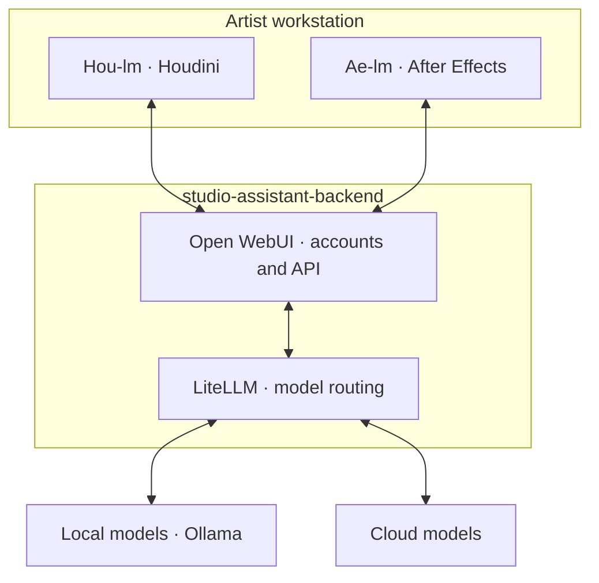

# Ae-lm

**After Effects client for [studio-assistant-backend](https://github.com/Byter3/studio-assistant-backend).** [Backend setup](https://github.com/Byter3/studio-assistant-backend/blob/main/docs/server-setup.md) · [Houdini client](https://github.com/Byter3/Hou-lm)

Conversational composition inspection, ExtendScript editing and reference-driven visual refinement. **Unsigned Windows preview · AE 2024–2026 manifest range; AE 2026 experimental.**

## Shared backend

Clients send context, images and tool results through the service. Commands execute locally in Houdini or AE. An existing compatible Open WebUI service works too.

## Install

1. [Download source](https://github.com/Byter3/Ae-lm/archive/refs/heads/main.zip). Copy `extension/` to `%APPDATA%\Adobe\CEP\extensions\studio.aelm`.
2. Apply the two [unsigned CEP settings](docs/install.md#enable-unsigned-extensions), restart AE, then open **Window → Extensions → Ae-lm Assistant**.
3. In **Settings**, enter your Open WebUI base URL and user API key; select a tool-capable model. A matching saved Hou-lm login reconnects automatically.

No separate Node, Python or local server installation.

## Use

Review scripts with **Apply once / Reject**, or enable **Auto-run scripts**. Expand activity cards for exact source/results. **Attach** adds references; **Viewport access** enables visible Composition-viewer feedback. Images need a vision-capable model. Visual checks default to 12 per task, adjustable in Settings.

History saves to `.aelm/<project>.json` with adjacent `.json.assets`; Save As carries it forward.

> Inspect the active composition. Report its name, dimensions, duration and layer count without changing anything or rendering.

[Install/update](docs/install.md) · [Visual workflow](docs/visual-workflow.md) · [Test prompts](docs/first-milestone.md) · [Compatibility](docs/validation.md) · [Development](CONTRIBUTING.md) · [Security](SECURITY.md) · [MIT](LICENSE)
